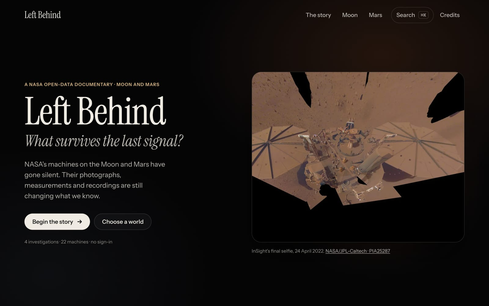
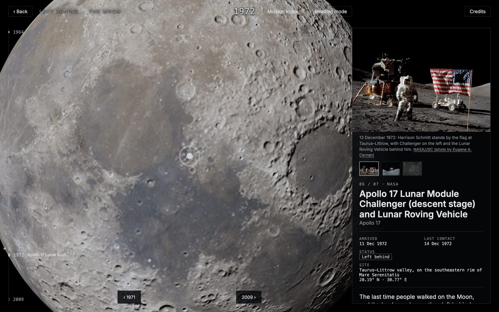
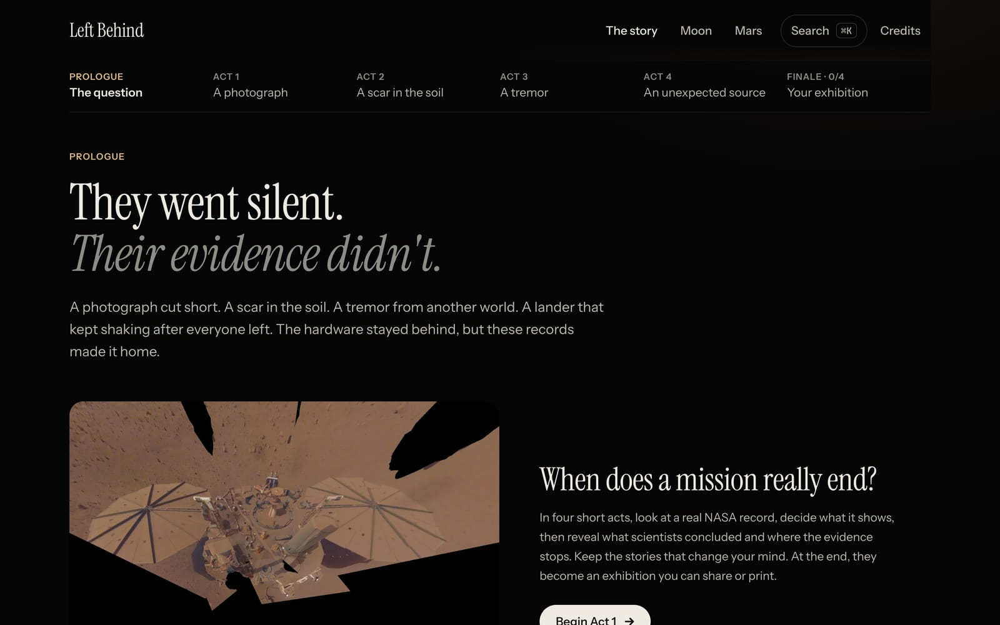
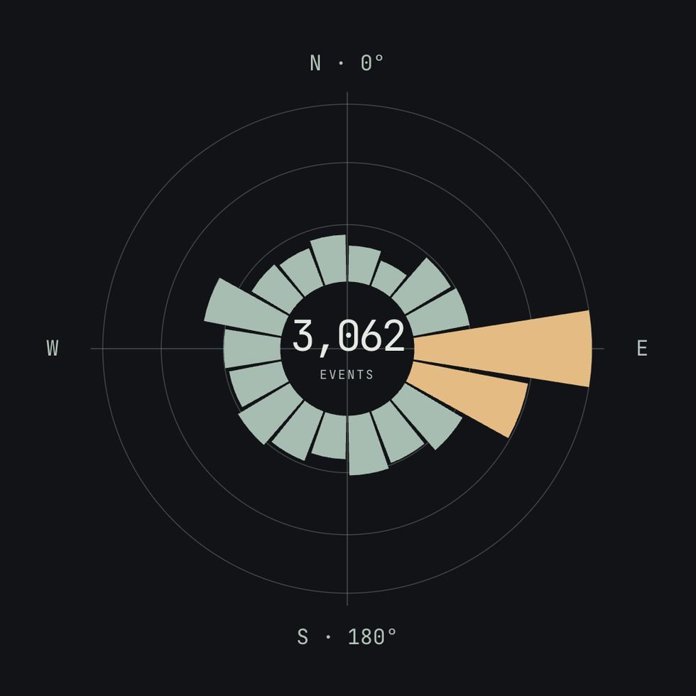

# Left Behind

**They went silent. Their evidence didn't.**

An interactive documentary about the NASA hardware left behind on the Moon and Mars, built for
**NASA Space Apps Challenge 2026** in response to
[Abandoned but not Forgotten: Storytelling about NASA's Discarded Equipment on the Moon and Mars](https://www.spaceappschallenge.org/2026/challenges/nasas-discarded-equipment-storytelling/).

**[Live site](https://left-behind-mu.vercel.app)** · [Demo deck](https://left-behind-mu.vercel.app/demo/) · [29-second video](https://left-behind-mu.vercel.app/demo/left-behind-demo.mp4)



## What it is

Left Behind has two parts:

- **After the Signal** takes you through four investigations: Ranger 7's last photographs, Spirit's silica
  discovery, InSight's final vibrations and an Apollo 17 seismic mystery. You work from real NASA
  images and seismic audio, separate what was observed from what was interpreted, then curate a
  source-linked exhibition you can share or print.
- **The atlas** covers 22 relic stories on a 3D globe of the Moon or Mars. Scroll through time and
  the globe turns to face each landing site, with NASA imagery, optional 3D models and a reading
  mode that works without WebGL.

| The Moon | Investigation | Apollo 17 seismic explorer |
| --- | --- | --- |
|  |  |  |

## Highlights

- **Scroll-driven 3D globe:** real NASA/USGS textures and normal maps. As you scroll, the globe
  slerps between relic coordinates, so their real positions drive the story.
- **Seismic data explorer:** 3,250 published Apollo moonquake events, filterable by month and
  estimate quality, with per-sensor arrival picks and a downloadable evidence receipt.
- **Opt-in offline pack:** a service worker caches every investigation, audio file and the
  catalog, using SHA-256 Subresource Integrity and versioned editions.
- **Accessible by default:** full keyboard navigation, reading mode without WebGL,
  reduced-motion support and shareable deep links for every relic and view.
- **Source-verified:** every fact links to a NASA source and was checked by hand. A stricter
  `test:final` gate enforces verification and attribution.

## Tech stack

- **Frontend:** React 19, TypeScript, Vite
- **3D:** Three.js, React Three Fiber, drei, maath
- **State:** Zustand
- **Offline:** custom service worker with Subresource Integrity
- **Quality:** Vitest, oxlint, GitHub Actions CI
- **Hosting:** Vercel

## How it works

```
src/
  engine/    3D globe, camera rig, site markers, model viewer
  ui/        landing, story cards, timeline rail, search, reading mode
  data/      relic stories and the source-linked data contract
  offline/   opt-in service worker and offline pack
  state/     timeline and routing state (Zustand)
```

The engine is deliberately simple: one textured sphere, one camera and a scroll offset. The scroll
position becomes a fractional relic index. The globe interpolates between "face this site"
quaternions for neighbouring relics, and the camera eases out between sites and back in when a
site is centred. See [docs/ENGINE.md](docs/ENGINE.md) for details.

## Run locally

Requires Node.js 22.

```text
npm ci
npm run dev
```

Production build and checks:

```text
npm run build && npm run preview
npm test
npm run lint
```

## Documentation

- [User guide](docs/GUIDE.md): every feature, keyboard shortcuts, offline pack, data scripts and validation
- [Engine architecture](docs/ENGINE.md)
- [Relic data contract](docs/DATA_CONTRACT.md)
- [NASA data and attribution](docs/NASA_DATA.md)
- [Source verification](docs/VERIFY.md) and [evidence log](docs/EVIDENCE.md)
- [Challenge alignment](docs/CHALLENGE.md) and [submission](docs/SUBMISSION.md)

## Team

Built by **Ibrahim** ([BiboEng](https://github.com/BiboEng)) and **Rayan** ([rayanali2](https://github.com/rayanali2)) as **Team Space Agents**
for NASA Space Apps Challenge 2026.

## AI assistance

Ibrahim and Rayan defined the project concept and original direction. Devin (Cognition) assisted
with mission discovery, narrative polish, reading-mode/navigation changes and model integration,
and proposed and implemented After the Signal, including interaction design, draft prose, tests and
documentation. Claude (Anthropic) assisted with deployment, an offline-mode fix, the demo deck and
captioned screen recording, the classroom guide, the Canadian Space Agency connection text and
submission drafting. The team reviewed this contribution against current Space Apps AI guidance and
confirmed it is disclosed accurately. New educational text was AI-assisted, grounded in linked NASA
sources and reviewed by the team. NASA photos, audio, textures and models are credited source assets,
not AI-generated media.

## License and credits

Code is released under the [MIT License](LICENSE). NASA imagery, audio, textures and 3D models are
NASA/USGS source assets credited in-app and in [docs/NASA_DATA.md](docs/NASA_DATA.md). The Apollo
seismic catalog is the unchanged CC0 dataset from Civilini, Husker and Weber. This is a curated
selection of stories, not a complete inventory of objects on the Moon or Mars.

*This project is not affiliated with or endorsed by NASA.*
